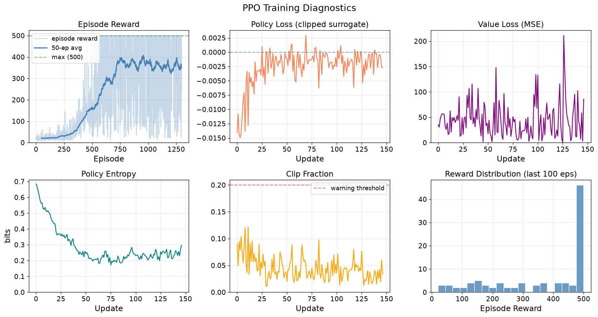
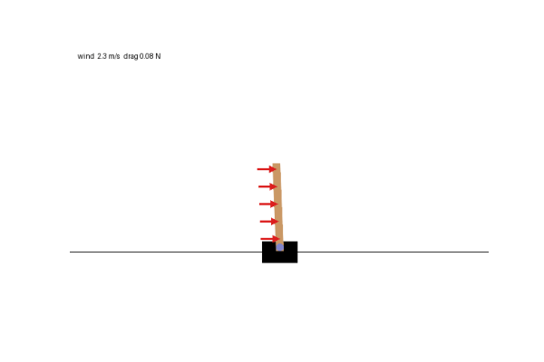
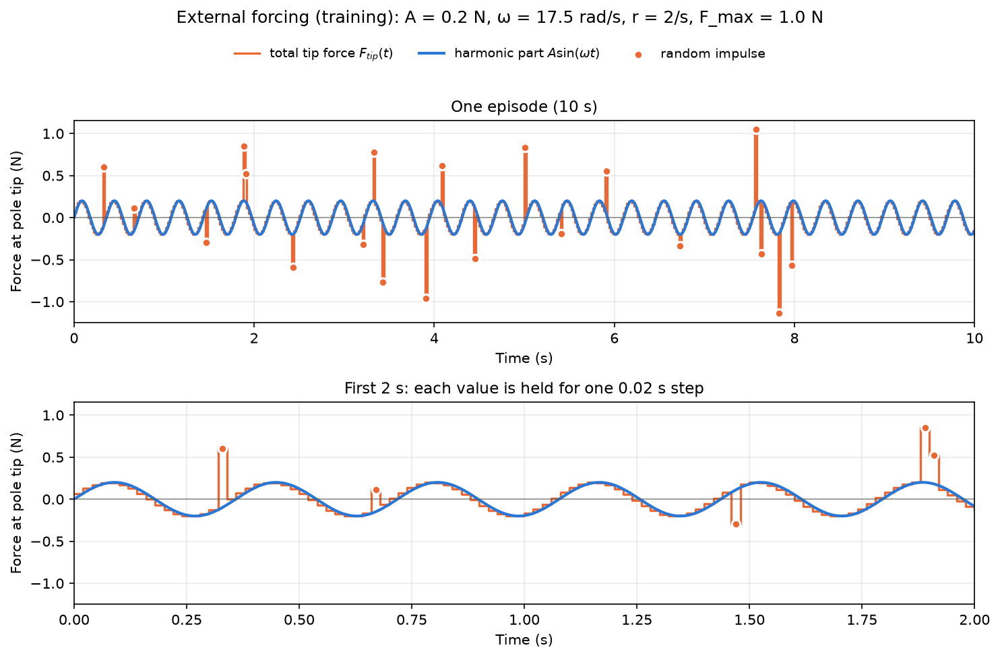

# PPO CartPole with Wind Forcing and Perception Latency

## Contents

1. [Summary](#1-summary)
2. [Episodes, termination and reward](#2-episodes-termination-and-reward)
3. [PPO agent](#3-ppo-agent)
    1. [Actor and critic](#31-actor-and-critic)
    2. [Objective](#32-objective)
    3. [Clipped surrogate objective](#33-clipped-surrogate-objective)
    4. [Advantage: GAE](#34-advantage-gae)
    5. [Loss](#35-loss)
    6. [Rollout buffer](#36-rollout-buffer)
    7. [Training loop](#37-training-loop)
4. [Results](#4-results)
5. [Inference and rendering](#5-inference-and-rendering)
6. [Physics model](#6-physics-model)
7. [Time integration](#7-time-integration)
8. [External forcing: wind](#8-external-forcing-wind)
9. [Perception latency](#9-perception-latency)
10. [How to run](#10-how-to-run)
11. [High-level design](#11-high-level-design)
12. [Project contents](#12-project-contents)
13. [Environment](#13-environment)
14. [Parameters](#14-parameters)

## 1. Summary

This project implements PPO (Proximal Policy Optimization) and trains it on CartPole with two additions: turbulent wind blowing on the pole and the cart, and a 0.04 s perception latency. The agent never observes the wind and acts on a delayed state, so the problem is partially observable and harder than standard CartPole. After 300,000 training steps, 11 of 20 evaluation episodes last the full 500 steps (10 s).

Gymnasium simulates the dynamics of the environment and provides the reward. 

At each time step, the agent chooses one of two actions:

- apply a constant force to the left
- apply a constant force to the right

The state of the environment is given by four continuous variables, $s = [x, \dot{x}, \theta, \dot{\theta}]$: the cart position and velocity, and the pole angle and angular velocity.

The wind drag force and the perception latency are implemented as a Gymnasium wrapper in the notebook.

1. **External forcing**. A steady mean wind plus random turbulent gusts blows on the pole and the cart, producing aerodynamic drag on both. The agent only sees its effect on the cart and pole. [External forcing: wind](#8-external-forcing-wind).

2. **Perception latency**. The agent sees the state from 2 time steps ago, $o_t = s_{t-2}$, and acts on it as if it were the current state. [Perception latency](#9-perception-latency).

## 2. Episodes, termination and reward

An episode is one attempt to balance the pole for 500 steps or until it fails.

- **Failure:** the episode ends prematurely if the pole tilts more than 12 degrees from vertical position, $|\theta| > 0.2094$ rad, or if the cart leaves the track, $|x| > 2.4$ m.

- **Time limit:** the episode has a maximum time limit of 500 steps (10 s).

- **Reward:** +1 for every step the pole stays up.

Failing early results in fewer future rewards, which turns balancing the pole into a learnable objective.

When balancing fails, the future rewards are zero. Actions that led toward failure get lower advantages, and the policy learns to avoid them.

When the time limit of 500 steps is reached, the critic's estimate of future rewards $V_\phi(o)$ is used in place of the missing future, rather than treating the time limit as a failure.

## 3. PPO agent

### 3.1 Actor and critic

- Actor model $\pi_\theta(a \mid o)$ outputs action probabilities from the observation,
- Critic model $V_\phi(o)$ estimates the expected return from that observation.

Both see only the delayed observation $o_t$, not the physical state $s_t$.

### 3.2 Objective

The true objective is the expected discounted return $G_0$:

$$
J(\theta) = \mathbb{E}_{\tau \sim \pi_\theta}\Big[\sum_t \gamma^t r_t\Big] = \mathbb{E}_{\tau \sim \pi_\theta}\big[G_0\big], \qquad G_t = \sum_{k \ge 0} \gamma^k r_{t+k}
$$

$J$ averages the return over trajectories generated by $\pi_\theta$, so evaluating it at new $\theta$ requires new episodes. PPO instead reuses one batch from $\pi_{\theta_{old}}$ for several gradient steps, reweighting each step by the importance sampling ratio $\rho_t(\theta)$.

### 3.3 Clipped surrogate objective

PPO algorithm trains the actor model by gradient ascent on the clipped objective function.

$$
L^{CLIP}(\theta) = \mathbb{E}_{(o_t, a_t) \sim \pi_{\theta_{old}}}\Big[\min\big(\rho_t(\theta) A_t,\ \text{clip}\big(\rho_t(\theta), 1-\epsilon, 1+\epsilon\big) A_t\big)\Big]
$$

$$
\rho_t(\theta) = \frac{\pi_\theta(a_t \mid o_t)}{\pi_{\theta_{old}}(a_t \mid o_t)}
$$

with $\epsilon = 0.2$. The clip removes the incentive to push $\rho_t$ outside $[0.8, 1.2]$, keeping $\pi_\theta$ close to $\pi_{\theta_{old}}$, where the surrogate is accurate. It is not a hard bound on the action probabilities.

### 3.4 Advantage: GAE

The advantage $A_t$ is computed with generalized advantage estimation (GAE):

$$
\delta_t = r_t + \gamma V_\phi(o_{t+1}) - V_\phi(o_t)
$$

$$
A_t = \sum_{k \ge 0} (\gamma\lambda)^k \delta_{t+k}
$$

with $\gamma = 0.99$, $\lambda = 0.95$. GAE mixes observed rewards with the critic's estimates, so $A_t$ is not a pure Monte Carlo return.

### 3.5 Loss

The critic is trained by regression on the targets $\hat R_t = A_t + V_{\phi_{old}}(o_t)$, an estimate of $G_t$ computed once per batch, before $A_t$ is normalized:

$$
L^V(\phi) = \mathbb{E}_t\Big[\big(V_\phi(o_t) - \hat R_t\big)^2\Big]
$$

Combined loss, minimized:

$$
L(\theta, \phi) = -L^{CLIP}(\theta) + c_1 L^V(\phi) - c_2 H\big(\pi_\theta(\cdot \mid o_t)\big)
$$

with $c_1 = 0.5$, $c_2 = 0.01$.

$H = -\sum_a \pi_\theta(a \mid o) \ln \pi_\theta(a \mid o)$ is the entropy of the action distribution: 0 for a deterministic policy, $\ln 2$ for a 50/50 one. PPO learns only from the actions it takes. If the policy turns deterministic early, it stops trying the other action, never collects the data that would show it is better, and stays stuck. The entropy bonus penalizes certainty, so the policy commits to an action only where the advantage justifies it. Too large a $c_2$ keeps the policy near random.

Actor and critic are separate networks with no shared weights. Both are trained on the same minibatch from the same buffer, in one backward pass and one Adam step. $\theta$ appears only in $L^{CLIP}$ and $H$, and $\phi$ only in $L^V$, so each network gets only its own gradient:

$$
\nabla_\theta L = -\nabla_\theta L^{CLIP} - c_2 \nabla_\theta H, \qquad \nabla_\phi L = c_1 \nabla_\phi L^V
$$

This is equivalent to two separate updates, except that the gradient norm is clipped to 0.5 jointly over $\theta$ and $\phi$. A large critic gradient therefore also shrinks the actor step.

### 3.6 Rollout buffer

One batch of 2048 consecutive steps from $\pi_{\theta_{old}}$, spanning several episodes:

| Entry | Shape | Type | Content |
|---|---|---|---|
| $o_t$ | $[2048, 4]$ | float32 | delayed observation $[x, \dot{x}, \theta, \dot{\theta}]$ |
| $a_t$ | $[2048]$ | int64 | 0 = left, 1 = right |
| $\ln \pi_{\theta_{old}}(a_t \mid o_t)$ | $[2048]$ | float32 | old log-probability, for $\rho_t$ |
| $r_t$ | $[2048]$ | float | +1, plus $\gamma V_\phi(o_{t+1})$ at the time limit |
| $d_t$ | $[2048]$ | bool | episode end: failure or time limit |
| $V_{\phi_{old}}(o_t)$ | $[2048]$ | float32 | old value estimate, for GAE |

$d_t$ stops GAE from summing across episode boundaries. The last step bootstraps from $V_{\phi_{old}}(o_{2048})$, a scalar. GAE then adds $A_t$ and $\hat R_t$, each $[2048]$. A minibatch is 64 random rows of $o_t$, $a_t$, $\ln \pi_{\theta_{old}}$, $A_t$, $\hat R_t$.

### 3.7 Training loop

1. Run the current policy for 2,048 steps and fill the rollout buffer.
2. Compute the GAE advantages backward through the batch and normalize them.
3. For 10 epochs over shuffled minibatches of 64, take an Adam step on $L(\theta, \phi)$.
4. Discard the batch and repeat.

See my hand-written notes on the derivation of the policy gradient, the clipped objective and GAE: [PPO notes](PPO_NOTES.md).

## 4. Results



The 50 episode average reward rises to about 400 within roughly 100,000 steps and then stays between 350 and 400.

## 5. Inference and rendering



The GIF shows one episode of inference.

- At each step the agent takes the most likely action, $\arg\max_a \pi_\theta(a \mid o)$.

- We first run 20 evaluation episodes with fixed seeds 0–19 and print the length of each. The GIF replays the longest one. With the current seeds, 11 of the 20 episodes continue for the full 500 steps, the other nine fail between 113 and 488 steps (median over all 20: 500). The GIF shows a successful episode, which is slightly more common than not.

- GIF plays in real time at 50 Hz, one frame per simulation step ($\Delta t = 0.02$ s).

## 6. Physics model

CartPole is a simple coupled mechanical system: a cart moves along the x-axis while a pole rotates about the pivot. The task of the agent is to keep the pole balanced.

Gymnasium models the pole as a uniform rod of mass $m$ and length $2l$ (its `length` parameter is $l$) on a cart of mass $M$. The angle $\theta$ is measured clockwise from upright position. With a horizontal force $F$ applied by the agent on the cart, the coupled equations of motion are:

Conservation of linear momentum in x-dir:

$$
F = (M + m) \ddot{x} + m l \cos\theta \ddot{\theta} - m l \dot{\theta}^2 \sin\theta
$$

Conservation of angular momentum around z axis:

$$
m g l \sin\theta = \tfrac{4}{3} m l^2 \ddot{\theta} + m l \cos\theta \ddot{x}
$$

The first equation is $F = M\ddot{x} + m \ddot{x}_{cm}$, where $x_{cm} = x + l\sin\theta$ is the horizontal position of the pole's center of mass:

$$
\ddot{x}_{cm} = \ddot{x} + l\cos\theta \ddot{\theta} - l\sin\theta \dot{\theta}^2
$$

- $\ddot{x}$: the pivot moves with the cart.
- $l\cos\theta \ddot{\theta}$: horizontal component of the pole's tangential acceleration.
- $-l\sin\theta \dot{\theta}^2$: horizontal component of its centripetal acceleration. Relative to the pivot, the center of mass moves on a circle of radius $l$, so it has acceleration $l\dot{\theta}^2$ directed along the pole toward the pivot. A fast-swinging pole pulls on the pivot along its axis, and when tilted, part of that pull acts horizontally on the cart. The term is nonlinear, of order $\theta\dot{\theta}^2$ near upright, so it vanishes when the equations are linearized; the simulation keeps it.

In the second equation, the term $m l \cos\theta \ddot{x}$ reflects the inertial torque from the acceleration of the pivot that connects the pole to the cart, since it accelerates with the cart.

$\tfrac{4}{3} m l^2$ is the rod's moment of inertia about the pivot. The $\cos\theta$ terms couple the two: accelerating the cart tips the pole, and the swinging pole pushes back on the cart. Gravity ($+m g l \sin\theta$) makes the upright position unstable.

These are Gymnasium's equations, without wind. The wind adds external forces on both bodies: the drag on the cart $F_{cart}$ and the drag on the pole $F_{pole}$ (acting at mid-pole). With them the equations become

$$
F + F_{cart} + F_{pole} = (M + m) \ddot{x} + m l \cos\theta \ddot{\theta} - m l \dot{\theta}^2 \sin\theta
$$

$$
m g l \sin\theta + F_{pole} l \cos\theta = \tfrac{4}{3} m l^2 \ddot{\theta} + m l \cos\theta \ddot{x}
$$

See [External forcing: wind](#8-external-forcing-wind) for how the wind forces are computed and applied.

There is **no friction**: neither between the cart and the track nor at the pivot. (The original Barto et al. (1983) model had both; Gymnasium drops them.)

## 7. Time integration

Gymnasium advances the system in discrete time steps of $\Delta t = 0.02$ s. At each step:

1. The agent's force $F = \pm 10$ N is held constant over the whole step.
2. The equations of motion above are solved for $\ddot{x}$ and $\ddot{\theta}$ from the current state.
3. The state is advanced with explicit (forward) Euler integration. Positions use the velocities from the *start* of the step:

$$
x_{n+1} = x_n + \Delta t \dot{x}_n, \qquad \dot{x}_{n+1} = \dot{x}_n + \Delta t \ddot{x}_n
$$

$$
\theta_{n+1} = \theta_n + \Delta t \dot{\theta}_n, \qquad \dot{\theta}_{n+1} = \dot{\theta}_n + \Delta t \ddot{\theta}_n
$$

Gymnasium can also use semi-implicit Euler (`kinematics_integrator="semi-implicit euler"`), which updates velocities first and then advances positions with the new velocities. This project uses the default, explicit Euler.

Explicit Euler is not energy-conserving, but the pole never swings past 12° (see below), so the drift is negligible here.

## 8. External forcing: wind

Wind blows horizontally on the pole and the cart, modeled the way wind loads are modeled in engineering: a mean wind plus turbulent gusts, converted to forces by aerodynamic drag.

The wind speed is a steady mean plus random fluctuations:

$$
u(t) = U + u'(t)
$$

The gust $u'(t)$ follows the **von Kármán turbulence spectrum**, the standard model for atmospheric turbulence:

$$
S_u(f) = \sigma_u^2 \frac{4 T_L}{\big(1 + 70.8 (f T_L)^2\big)^{5/6}}, \qquad T_L = \frac{L}{U}
$$

where $\sigma_u$ is the gust intensity and $T_L$ the integral time scale (the duration of a turbulent wind gust).

**Drag force.** The same wind acts on both bodies. Each experiences a quadratic wind drag force:

$$
F(t) = \tfrac{1}{2} \rho C_d A |u(t)| u(t)
$$

with its own drag coefficient $C_d$ and frontal cross-sectional area $A$:

- Pole is a circular cylinder. The load is spread uniformly along the pole.
- Cart is a cube whose side is 1/5 of the pole length (0.2 m).

The cart has twice the pole's frontal cross-sectional area. The same wind model is used in training and inference.



The figure shows one 10 s episode (seeded for reproducibility). Top: the wind speed, with slow gusts lasting a few seconds and small fast fluctuations on top, as in real wind. Bottom: the resulting drag force on the cart and on the pole. The force on the cart is larger because of its larger cross-sectional area. Since the wind force is proportional to $u^2$, gusts are amplified. The wind varies by about ±30%, but the forces vary by more than a factor of ten.

**Applying the forces.** Over one time step $\Delta t$, the wind force is applied as an impulse $J = F \Delta t$, which changes $\dot{x}$ and $\dot{\theta}$ through the mass matrix of the equations of motion. The generalized impulse depends on where the force acts:

- **Pole** (at height $l$): $(J_{pole}, l\cos\theta J_{pole})$. It pushes the system and tips the pole directly.
- **Cart** (at the cart): $(J_{cart}, 0)$. It exerts no torque on the pole directly, but accelerating the cart tips the pole through the $\cos\theta$ coupling, just like the agent's own push.

Both impulses are applied just before Gymnasium's Euler step.

**Why the wind is limited to a light breeze.** Real wind has a nonzero mean, so to stay balanced the pole must lean *into* the wind. With the pole's drag and weight both acting at mid-pole, and the cart held stationary on average, the steady equilibrium lean is

$$
\tan\theta_{eq} = \frac{F}{m g}
$$

where $F$ is the drag on the pole; the cart's drag does not change the lean. The pole weighs only 0.1 kg ($m g$ = 0.98 N), so it is very sensitive to wind. At 2.5 m/s the mean drag of 0.09 N gives a leaning angle of about 5°. At 4 m/s the lean would be about 13°, beyond the 12° failure limit: no controller could keep the pole up. The largest tolerable mean drag is $m g \tan 12° \approx 0.21$ N.

The difficulty is that the wind pushes **persistently in one direction**. Together the pole and cart catch about 0.25 N of mean drag, so the whole system is blown downwind. The agent has to hold the pole tilted into the wind and keep the cart on the track.

## 9. Perception latency

The agent perceives the state $\tau = 0.04$ s (2 time steps) late. At step $n$ its only input is the state from 2 steps earlier,

$$
o_n = s_{n-2} = [x, \dot{x}, \theta, \dot{\theta}]_{n-2}
$$

and it acts on it as if it were the current state. This models the time it takes to sense the cart and pole and process what it sees before acting. Together with the unobserved wind, the delay makes the problem partially observable.

**Efference copy.** The brain faces the same problem, sensory feedback arrives 100–200 ms late. It compensates with an efference copy, an internal copy of each motor command sent to the brain regions that predict movement. Combining the delayed sensory signal with the commands issued since, it estimates the body's current state before the feedback arrives (a forward model). Autonomous vehicles do the same, under the name latency compensation.

The PPO agent here has no efference copy or memory, it acts on the delayed state alone.

## 10. How to run

```bash
pip install "gymnasium[classic-control]" torch numpy matplotlib pillow jupyter
jupyter notebook ppo_cartpole.ipynb
```

Run the cells in order. Training takes about 2 minutes on a laptop CPU. All randomness is seeded, so a re-run gives the same policy, figures and GIF.

## 11. High-level design

The notebook runs top to bottom in four stages: building blocks, environment, training, then analysis and output.

```
┌──────────────────── BUILDING BLOCKS ─────────────────────┐
│ PolicyNetwork π_θ(a|o) 4 → 64 → 64 → 2 (actor) │
│ ValueNetwork V_φ(o) 4 → 64 → 64 → 1 (critic) │
│ RolloutBuffer one batch of experience │
│ compute_gae() δ_t, A_t, returns │
│ ppo_update() clipped loss + value + entropy │
└──────────────────────────────────────────────────────────┘
                             │
┌────────────────────── ENVIRONMENT ───────────────────────┐
│ agent │
│ ⇅ │
│ PerceptionLatency observation o_t = s_{t-2} │
│ ⇅ │
│ ExternalForcing wind drag on pole and cart │
│ ⇅ │
│ CartPoleEnv ±10 N push, Euler step, limits │
└──────────────────────────────────────────────────────────┘
                             │
┌───────────────────── TRAINING LOOP ──────────────────────┐
│ repeat ~146 times (300k steps): │
│ 1. collect 2,048 steps with π_θ (sampled actions) │
│ 2. compute_gae() │
│ 3. ppo_update(): 10 epochs × minibatches of 64 │
│ 4. clear buffer │
└──────────────────────────────────────────────────────────┘
                             │
┌────────────────── ANALYSIS AND OUTPUT ───────────────────┐
│ training diagnostics → ppo_diagnostics.png │
│ wind forcing → external_forcing.png │
│ 20 seeded evaluation episodes (argmax policy) │
│ GIF of the longest → cartpole_trained_rollout.gif │
└──────────────────────────────────────────────────────────┘
```

## 12. Project contents

- `ppo_cartpole.ipynb` — full PPO implementation, training loop, diagnostics, and animation export
- `PPO_NOTES.md` — handwritten derivations
- `pyproject.toml` — project dependencies
- `resources/` — generated diagnostic figures and animation artifacts

## 13. Environment

- Python
- Gymnasium
- PyTorch
- NumPy
- Matplotlib
- Pillow
- pygame (used by Gymnasium to render the animation)

## 14. Parameters

### Cart-pole

| Parameter | Symbol | Value |
|---|---|---|
| Cart mass | $M$ | 1.0 kg |
| Pole mass | $m$ | 0.1 kg |
| Pole half-length | $l$ | 0.5 m (full pole 1.0 m) |
| Gravity | $g$ | 9.8 m/s² |
| Agent's force on the cart | $F$ | ±10 N |
| Time step | $\Delta t$ | 0.02 s |

### Wind

| Parameter | Symbol | Value |
|---|---|---|
| Mean wind speed | $U$ | 2.5 m/s (a light breeze) |
| Turbulence intensity | $\sigma_u / U$ | 30% ($\sigma_u$ = 0.75 m/s) |
| Turbulence length scale | $L$ | 5 m ($T_L$ = 2 s) |
| Air density | $\rho$ | 1.2 kg/m³ |
| Pole: drag coefficient (cylinder) | $C_d$ | 1.2 |
| Pole: diameter | $D$ | 2 cm (frontal area 0.02 m²) |
| Cart: drag coefficient (cube, face-on) | $C_d$ | 1.05 |
| Cart: side length | | 0.2 m (frontal area 0.04 m²) |
| Resulting drag on the pole | $F_{pole}$ | about 0.09 N mean, 0.01–0.22 N over an episode |
| Resulting drag on the cart | $F_{cart}$ | about 0.16 N mean, up to 0.39 N over an episode |

### PPO

| Parameter | Value |
|---|---|
| Actor and critic | 2 hidden layers of 64 units, tanh |
| Optimizer | Adam, learning rate $3 \times 10^{-4}$ |
| Total training steps | 300,000 |
| Rollout length | 2,048 steps |
| Epochs per rollout | 10 |
| Minibatch size | 64 |
| Discount $\gamma$ | 0.99 |
| GAE $\lambda$ | 0.95 |
| Clip $\epsilon$ | 0.2 |
| Value-loss coefficient | 0.5 |
| Entropy coefficient | 0.01 |
| Gradient-norm clip | 0.5 |
